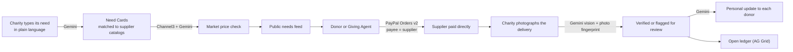

# Stone Soup

> *In the old folk tale, hungry travellers set a pot of water and a stone over a fire in a village
> that wouldn't share. Curious villagers each added one thing — a carrot, an onion, a pinch of salt —
> until the "stone soup" fed everyone.*

**Stone Soup turns donations into verified purchases.** Instead of sending cash and hoping, a donor funds
a specific item a small charity needs — a blanket, a backpack, a bag of rice. PayPal pays the supplier
directly, the price is checked against the market, and the donor sees a photo when it's delivered.

Built for the PayPal **Build What's Next with PayPal and AI** hackathon.

## Demo video

**[Watch the 2½-minute demo](docs/stone-soup-demo.mp4)**: one $18 blanket followed from the Giving Agent,
through PayPal straight to the supplier, to a Gemini-checked delivery photo, plus the features around every
gift. Recorded on the PayPal sandbox with the real app.

## The problem

- Individual donors are leaving: donor counts have fallen every year since 2021, and roughly 4 in 5
  first-time donors never give again (Fundraising Effectiveness Project, 2025).
- The top reason is not knowing what the money did: 24% of lapsed donors cite lack of transparency
  (Bloomerang, 2025); 68% say trust is essential but only 18% highly trust charities (BBB Give.org, 2026).
- Small charities — 73% of US nonprofits take in under $500K a year — have no staff to prove spending or
  report back, and AI-generated fake charities make photos and reports easy to fake.

Every platform answers with "give cash, then try to prove where it went". Stone Soup removes the cash.

## How it works



1. **A charity describes what it needs** ("rice for 30 people for two weeks"). Gemini turns it into
   specific needs with quantities — showing its arithmetic — and matches each to supplier catalogs.
2. **Prices are checked.** Each catalog item is compared with ~10 real products found through Channel3,
   with a Gemini pass that drops irrelevant results. The comparison products are saved, so the check is
   reproducible and visible to donors. Above-market prices need a written reason.
3. **Donors fund units, not causes.** One PayPal checkout pays each supplier directly (`payee`), with an
   optional unrestricted gift to the charity and an option to cover PayPal's fee. Stone Soup never holds
   the money.
4. **Or the Giving Agent does it.** "I have $50, I care about kids and winter relief" → Gemini searches
   open needs and proposes a basket through function calls; the server prices and validates every
   proposal and reports the remaining budget so the agent can improve it. The donor approves once.
5. **Delivery is confirmed with a photo.** Gemini vision checks the item, rough quantity and whether the
   photo looks genuine. Each photo is fingerprinted (an exact SHA-256 hash plus a perceptual hash), so a
   photo reused for another delivery is caught even after it has been re-saved, resized or cropped. Doubtful
   deliveries go to a human review queue — nothing is rejected automatically.
6. **Donors hear back.** Delivered units are allocated to gifts in order, and each donor whose units
   arrived gets a short personal update with the photo.
7. **Everything is public** in the open ledger: gift, supplier paid, amount, PayPal capture ID, price check
   and delivery status.

## PayPal integration

| Capability | Where it's used |
|---|---|
| **Orders v2 with `payee`** | Every purchase unit is paid to that need's supplier, not to the platform ([`src/lib/paypal.ts`](src/lib/paypal.ts)) |
| **Multiple purchase units** | One checkout funds up to 9 needs across suppliers plus an NGO gift ([`src/lib/donations.ts`](src/lib/donations.ts)) |
| **JS SDK v6** (`@paypal/react-paypal-js/sdk-v6`) | Donate button on need pages and the Giving Agent basket |
| **`PayPal-Request-Id` idempotency** | Safe retries of order creation and capture |
| **Webhooks** with signature verification | `CHECKOUT.ORDER.APPROVED` completes captures if the donor closes the page ([`src/app/api/paypal/webhook`](src/app/api/paypal/webhook/route.ts)) |
| **Capture IDs** | Shown per gift in the open ledger, and the key of each gift's public journey |
| **Approval links** (`payer-action`, `return_url`) | Gifts created by an AI assistant over MCP are approved on PayPal's site and captured on return ([`src/app/api/checkout/return`](src/app/api/checkout/return/route.ts)) |

Fee cover is calculated so the supplier receives the exact price after PayPal's fee (e.g. 2 blankets:
donor pays $37.81, supplier nets $36.00).

## AI: what Gemini does

All AI runs on Google Gemini through `@google/genai` ([`src/lib/gemini.ts`](src/lib/gemini.ts)), with a
model fallback chain (`gemini-3.8-flash` → `gemini-3.5-flash-lite` → `gemini-2.5-flash`), per-call
timeouts, and a cooldown for overloaded models.

| Feature | Technique | Code |
|---|---|---|
| Need intake | Structured output (JSON schema), quantity reasoning | [`src/lib/intake.ts`](src/lib/intake.ts) |
| Price-list photo → catalog | Vision + structured output | [`src/lib/catalog.ts`](src/lib/catalog.ts) |
| Market price relevance filter | Classification over Channel3 results | [`src/lib/relevance.ts`](src/lib/relevance.ts) |
| Giving Agent | Function calling loop (`search_needs`, `propose_basket`) with server-side validation | [`src/lib/agent.ts`](src/lib/agent.ts) |
| Delivery check | Vision + structured output, plus exact and perceptual photo hashes | [`src/lib/delivery.ts`](src/lib/delivery.ts) |
| Donor impact updates | Grounded generation from delivery facts | [`src/lib/delivery.ts`](src/lib/delivery.ts) |
| Snap the shelf | Vision + structured output; quantities computed in code | [`src/lib/intake.ts`](src/lib/intake.ts) |
| Scam Check | Google Search grounding, then structured assessment | [`src/lib/scam-check.ts`](src/lib/scam-check.ts) |
| Soup Club baskets | The Giving Agent, run monthly per member | [`src/lib/club.ts`](src/lib/club.ts) |
| Funder report summary | Generation from verified facts only | [`src/lib/report.ts`](src/lib/report.ts) |
## More ways to give and to trust

- **Give from any AI** ([`/connect`](src/app/connect/page.tsx), [`src/lib/mcp.ts`](src/lib/mcp.ts)) — an MCP
  server at `/api/mcp`, so Gemini CLI, Claude, ChatGPT or any MCP client can find needs, ask the Giving
  Agent for a basket and create a gift. The assistant never moves money: `create_gift` returns a PayPal
  approval link, and PayPal pays each supplier directly once the person approves.
- **Snap the shelf** — a charity photographs a half-empty pantry or linen closet; Gemini vision says what's
  low and how much to restock (the division into catalog units is done in code), and drafts matched,
  price-checked needs.
- **Live pot wall** ([`/pot/[slug]/live`](src/app/pot/[slug]/live/page.tsx)) — a big-screen group pot for
  events and classrooms: people scan the QR code and pay on their phones, the pot fills live with names and
  notes, and the delivery photo is revealed when it's verified.
- **Follow the dollar** ([`/journey/[captureId]`](src/app/journey/[captureId]/page.tsx)) — every step one
  gift took, from price check to PayPal capture to verified delivery and thank-you, with the PayPal IDs
  that prove it. Linked from every row of the ledger.
- **Verified charities only** ([`/ngo/join`](src/app/ngo/join/page.tsx), [`src/lib/verify.ts`](src/lib/verify.ts)) —
  Stone Soup never makes a page for a charity on its own, and no one can post needs in a charity's name
  without proving they run it. The EIN must be a 501(c)(3) in the IRS records (looked up through ProPublica's Nonprofit Explorer API); the
  charity publishes a code on its own website; Gemini with Google Search checks that the website is the
  charity's official one. If it can't confirm that, a reviewer (with the `REVIEW_KEY`) confirms the claim. A
  second claim on the same EIN is refused, and a registered charity's dashboard works only from the browser
  that registered it. (Answers the 2026 multistate complaint about donation pages created for charities without
  consent.)
- **Scam Check** ([`/check`](src/app/check/page.tsx)) — paste any appeal (link, text or screenshot);
  Gemini with Google Search grounding lists red flags with evidence and how to verify, and suggests
  verified needs for the same cause.
- **Soup Club** ([`/club`](src/app/club/page.tsx)) — a monthly budget; the Giving Agent prepares a basket
  each month and the member approves it with one PayPal tap.
- **Group pots** — share a link or QR code and pool gifts toward one need; nearly complete needs are
  suggested as "finish the pot".
- **Funder reports** ([`/ngo/[slug]/report`](src/app/ngo/[slug]/report/page.tsx)) — a printable report
  from verified data only: items delivered, savings against market prices, suppliers paid.

Guardrails: the model never sets amounts (prices come from the database); charity-written text is
passed to the agent as data, not instructions; flagged deliveries always go to a person.

## Sponsor tools

- **Channel3** — product search (agentic mode) for market-price benchmarks and product images; benchmark
  baskets are re-priced by product ID ([`src/lib/channel3.ts`](src/lib/channel3.ts), [`src/lib/benchmark.ts`](src/lib/benchmark.ts)).
- **AG Grid** — the open ledger: sorting, column and quick filters, totals row, pagination, themed to the
  site ([`src/components/ledger-grid.tsx`](src/components/ledger-grid.tsx)).
- **Render** — web service + Postgres via [`render.yaml`](render.yaml).

## Data sources

- **Charity records: IRS, via ProPublica.** When a charity registers, its EIN is looked up in the IRS
  exempt-organisation records through ProPublica's free
  [Nonprofit Explorer API](https://projects.propublica.org/nonprofits/api)
  (`GET /nonprofits/api/v2/organizations/{ein}.json`, no API key). We use the registered name, city and state,
  whether it is a 501(c)(3) (subsection code 3), and the IRS ruling year ("registered since"). The IRS itself
  publishes these records only as bulk downloads and a search site, with no live lookup API; ProPublica serves
  the same IRS data per EIN ([`src/lib/verify.ts`](src/lib/verify.ts)).
- **Market prices: Channel3.** Real retail products and prices used for each need's price check (see
  *Sponsor tools*).
- **Donor statistics** quoted above: Fundraising Effectiveness Project (2025), Bloomerang (2025),
  BBB Wise Giving Alliance / Give.org (2026).

## Run it locally

**Requirements:** Node.js 22+, Docker, a PayPal developer account, a Gemini API key, a Channel3 API key.

1. **PayPal sandbox** (developer.paypal.com):
   - Create a REST app (sandbox) and copy its client ID and secret.
   - Under *Testing Tools → Sandbox Accounts*, create two **business** accounts (supplier and charity).
     The default **personal** account is the donor.
2. **Configure:**
   ```bash
   git clone https://github.com/bhargava16623/stone-soup.git && cd stone-soup
   cp .env.example .env   # fill in the values (SESSION_SECRET: `openssl rand -base64 32`; REVIEW_KEY: any passphrase)
   npm install
   ```
3. **Database:**
   ```bash
   npm run db:up        # Postgres 16 in Docker on port 5433
   npm run db:migrate
   npm run db:seed      # demo charities, suppliers and needs; fetches live price checks (~2 min)
                        # or: npm run db:seed -- --no-benchmark  (fast, no price checks)
   ```
4. **Start:**
   ```bash
   npm run dev          # http://localhost:3000
   ```
5. **Try it:** fund a need with the sandbox personal account, ask the Giving Agent for a basket, post a
   need as Hope Shelter (*For organisations*), confirm a delivery with a photo, and check the ledger.
   To approve flagged deliveries or charity claims, open `/review` and enter your `REVIEW_KEY`.

## Deploy to Render

New → **Blueprint** → select this repo. Render creates the web service and Postgres from `render.yaml`
and asks for the secrets. After the first deploy, run `npm run db:seed` from the service's Shell, then
add `https://<your-app>.onrender.com/api/paypal/webhook` as a webhook in the PayPal developer dashboard
(event: *Checkout order approved*) and set `PAYPAL_WEBHOOK_ID`.

## Project structure

```
src/app/               pages and API routes (Next.js App Router)
  give/                Giving Agent
  needs/[id]/          need page with market check and donate panel
  ngo/join/            register a charity (IRS lookup), then ngo/[slug]/verify
  ngo/[slug]/          charity dashboard: intake and delivery confirmation
  vendor/[slug]/       supplier dashboard: catalog and orders to deliver
  ledger/              open ledger (AG Grid)
  gifts/[orderId]/     donor's gift tracking
  journey/[captureId]/ follow one gift step by step
  pot/[slug]/          group pot, and /live for the big screen
  club/                Soup Club monthly giving
  check/               Scam Check
  connect/             give from any AI (MCP setup)
  review/              review queue for charity claims and flagged deliveries (REVIEW_KEY)
  api/mcp/             MCP server
  api/checkout/        create and capture PayPal orders
  api/paypal/webhook/  verified PayPal webhooks
src/lib/               PayPal, Gemini, Channel3, checkout, intake, agent and delivery logic
src/db/                Drizzle schema and client
scripts/               seed script and spikes
```

## Limitations (honest list)

- **Sandbox only.** Suppliers are sandbox business accounts; the market check uses real retail prices
  from Channel3, but purchases go to the demo suppliers.
- **No accounts.** The two seeded charities are fictional, labelled "Demo charity", and their dashboards
  are open so anyone can try them. A charity registered at `/ngo/join` is managed only from the browser
  that registered it (a signed cookie). Production would use real sign-in with recovery. Reviewers unlock
  `/review` with a shared key. Supplier dashboards are open for the demo.
- **Rate limits are per server.** The AI endpoints are rate-limited per IP in memory, which is fine for one
  instance; scaling out would need a shared store.
- **Tax receipts.** In production, a fiscal sponsor or donor-advised fund would be the legal recipient
  so gifts are deductible; the demo doesn't claim deductibility.
- **Market data.** Channel3 covers retail goods well and groceries poorly; items without reliable data
  show "No market data" and need a written reason.
- **Photo checks are a signal, not proof.** They're combined with the PayPal payment record and
  supplier fulfilment, and doubtful cases go to a person.

## License

[MIT](LICENSE)
